# Entrega del tercer corte: construcción, pruebas y entrega

**Proyecto:** SILVA (Sistema Inteligente de Lenguaje Visual Aumentado), versión 1.0.0
**Equipo:** Equipo 3. Miguel Alejandro Jácome Yánez, Camilo Andrés Conde Corrales, Juan Diego Rosales Guillén
**Curso:** Ingeniería de Software, grupo 1206, Universidad Tecnológica de Bolívar
**Docente:** Aisner José Marrugo Juliao
**Fecha:** 24 de octubre de 2026
**Repositorio:** https://github.com/CamiloConde/SILVA
**Documentos que complementa:** [Silva-corte1.pdf](Silva-corte1.pdf) (secciones 1–8), [SILVA_diagramas_UMLv2.pdf](SILVA_diagramas_UMLv2.pdf) (modelado UML) y [SILVA_avance_requerimientos_corte2.md](SILVA_avance_requerimientos_corte2.md) (requerimientos, priorización y gestión)

Este documento desarrolla la sección 10 de la plantilla del proyecto de aula (tercer corte) y las secciones 12 a 14 (seguimiento, referencias y anexos). Las secciones 10.1 a 10.9 siguen la numeración de la plantilla para que puedan trasladarse directamente al documento consolidado. Antes de ellas se documentan los cambios de alcance y los requerimientos nuevos, porque el resto del documento se apoya en ellos.

> **Pendiente del equipo antes de entregar:**
> - Marcar con [completar] los campos que solo el equipo puede llenar: responsables, fechas de reuniones y observaciones del docente.
> - Revisar y firmar la declaración de uso de IA (sección 15).
> - Reemplazar las figuras de la interfaz por capturas reales con la cámara (sección 10.6).
> - Pedir la aprobación del docente para los cambios de alcance de la sección 1.

---

## 1. Cambios de alcance respecto al segundo corte

La plantilla permite ajustar el alcance «siempre que el cambio sea documentado y aprobado por el docente» (sección 3). Estos son los cambios ocurridos durante la construcción, con su justificación:

| # | Cambio | Por qué | Efecto en el modelado | Estado |
|---|---|---|---|---|
| C1 | **El MVP reconoce 17 letras, no todo el alfabeto.** Quedan fuera G, H, J, M, N, Ñ, P, Q, S y Z | Al medir el movimiento de cada letra en el dataset se vio que esas 10 letras se hacen con movimiento en LSC; su desplazamiento por cuadro es 4 a 40 veces mayor que el de las estáticas ([docs/dataset.md](../docs/dataset.md)). El alcance ya excluía las «señas dinámicas» | Ninguno | Aplicado |
| C2 | **El modelo de letras se entrenó; no se usó uno preentrenado.** El modelado UML decía «el equipo no entrena un modelo propio, sino que consume uno preentrenado» | No existe un modelo preentrenado público del alfabeto de LSC. Sí existe un dataset público de landmarks (JuanPlazas, 2026), con el que se entrenó un Random Forest | Se agregaron los scripts de preparación y entrenamiento. En la app, `ClasificadorPreentrenado` sigue cargando un modelo ya entrenado, como en la Figura 2 | Aplicado |
| C3 | **Nuevo modo Palabras: 33 expresiones de cortesía con movimiento** (hola, gracias, por favor, buenos días…) | Petición del equipo para que SILVA no se limite a deletrear. Se encontró un dataset colombiano de señas con movimiento grabado por 18 personas (LSC-54; Mora-Zarate et al., 2025) | Clases nuevas `DetectorCuerpo`, `SegmentadorSenas` y `ClasificadorPalabras` (sección 11) | **Pendiente de aprobación del docente** |
| C4 | **Nueva función Responder (RF-09):** la persona oyente escribe y su respuesta se muestra en grande | Pregunta abierta del equipo del 21/09/2026 ([Notaplanteamiento](Notaplanteamiento)): sin esto, la persona sorda no se entera de lo que le responden | Clase nueva `DialogoRespuesta` y tabla `respuestas` en el historial | **Pendiente de aprobación del docente** |
| C5 | **La interfaz pasó de Tkinter a PySide6 (Qt), con el procesamiento de video en un hilo aparte** | Con Tkinter, el video y la detección compartían un solo hilo y la ventana se trababa. Qt permite el paralelismo que ya describía la Figura 6 | `VentanaPrincipal` se reimplementó y se agregó `TrabajadorVideo`. El controlador no cambió | Aplicado |
| C6 | **MediaPipe queda fijo en la versión 0.10.21** | Las versiones que publica Google desde la 0.10.22 envían estadísticas de uso a `play.googleapis.com` sin forma de desactivarlo (cchadowitz, 2026). Se detectó en las pruebas con la cámara, e incumplía RNF-01 | Ninguno | Aplicado |
| C7 | **Distribución como ejecutable de Windows** (antes: «aplicación de escritorio en Python») | Para usar SILVA no debe hacer falta instalar Python (RNF-06) | Diagrama de despliegue actualizado (Figura 12) | Aplicado |

Siguen **fuera de alcance**:
- Traducir frases libres con la gramática de la LSC.
- Las versiones móvil y web.
- Otras lenguas de señas.
- Las letras con movimiento.
- Los colores y los números de LSC-54 (ver C3 y la sección 10.8).

## 2. Requerimientos actualizados

Los requerimientos RF-01 a RF-08 y RNF-01 a RNF-05 del segundo corte se mantienen sin cambios. Se agregan:

| ID | Requerimiento | Origen | Prioridad (MoSCoW) | Criterio de aceptación |
|---|---|---|---|---|
| RF-09 | El sistema debe permitir que la persona oyente escriba una respuesta y mostrarla en grande para la persona sorda | Cambio C4 | Importante | La respuesta ocupa el área del video con letra legible a distancia, se cierra con un clic o con Esc, y queda en el historial |
| RF-10 | El sistema debe reconocer 33 expresiones de cortesía con movimiento (modo Palabras) | Cambio C3 | Importante | Con personas que el modelo no vio, al menos 80 % de exactitud en la evaluación por persona |
| RF-11 | Si una seña es dudosa, el sistema no debe escribirla y debe pedir que se repita | Necesidad detectada al construir RF-10 | Importante | Las señas con confianza bajo el umbral muestran «No se reconoció la seña… Repítala» y no se agregan al texto |
| RF-12 | El sistema debe avisar cuando la persona no está bien encuadrada (modo Palabras) | Necesidad detectada al construir RF-10 (equivale a RF-06) | Deseable | Sin pose detectada aparece «Colóquese frente a la cámara: deben verse los hombros y las manos» |
| RNF-06 | Portabilidad y despliegue: debe poder usarse descargando un ejecutable, sin instalar Python ni dependencias | Cambio C7 | Importante | `SILVA.exe` funciona descomprimido en cualquier carpeta y pasa `--verificar --camara` |

Historias de usuario nuevas:
- **HU-06:** Como persona sorda, quiero expresar saludos y frases de cortesía completas con su seña, para no tener que deletrear cada palabra. *(RF-10, RF-11, RF-12)*
- **HU-07:** Como persona oyente, quiero escribir mi respuesta y que se muestre en grande, para que la persona sorda pueda leer lo que le contesto. *(RF-09)*
- **HU-08:** Como usuario, quiero descargar y abrir SILVA sin instalar nada, para usarlo en cualquier computador con cámara. *(RNF-06)*

---

## 10.1 Evolución del producto e iteraciones

Las fechas salen del historial de Git y de las fechas de modificación de los archivos. Las iteraciones 1 a 4 se construyeron sobre una copia local del repositorio que, a la fecha de este documento, **todavía no se ha subido a GitHub**. Por eso el historial público solo muestra la iteración 0 (ver 10.4).

| Iteración | Objetivo | Completado | Pendiente / cambio | Dificultades y decisiones | Evidencia |
|---|---|---|---|---|---|
| 0 (14–21 sep.) | Planteamiento, modelado y requerimientos | Plantilla (secciones 1–8), 6 diagramas UML, elicitación documental y benchmarking, RF/RNF, MoSCoW, tablero Trello | Repartir tarjetas del tablero | Se descartó simular entrevistas con usuarios ficticios; se usaron fuentes secundarias reales | Commits del 14 al 21 de septiembre |
| 1 (8 oct.) | Base técnica y MVP de letras | Estructura del repositorio; dataset de letras (JuanPlazas, 2026); análisis de letras estáticas y dinámicas; Random Forest de 17 letras; app de escritorio con captura, detección, confirmación (≥ 0,80 y 5 cuadros), historial SQLite; 30 pruebas | Grabar datos propios (objetivo 2) | **C1** (17 letras) y **C2** (modelo entrenado). La clasificación tardaba 38 ms por cuadro por el paralelismo de scikit-learn; con `n_jobs=1` bajó a 4,5 ms | [docs/metricas_modelo.md](../docs/metricas_modelo.md), [docs/dataset.md](../docs/dataset.md) |
| 2 (8 oct.) | Pulido visual y modo Palabras | Interfaz oscura; descarga y extracción de LSC-54 (2 880 videos); comparación de 4 clasificadores × 3 conjuntos de características; segmentador de señas; prueba de punta a punta con personas no vistas | Probar con la cámara de un portátil y personas reales (PR-27 a PR-29) | **C3.** El JSON de LSC-54 pesa 51 GB, así que se extrajeron los puntos de los videos originales (970 MB). Se descartaron los colores (MediaPipe no detecta la mano junto a la cara) y los números (bajaban la exactitud a 77 %). Las señas se partían en dos al perderse la mano, y se corrigió con las muñecas de la pose y una regla anti-duplicados | [docs/metricas_palabras.md](../docs/metricas_palabras.md), PR-25 y PR-26 |
| 3 (8 oct.) | Corrección de errores y migración de interfaz | Error «no se puede volver a iniciar» corregido; telemetría de MediaPipe detectada y eliminada (**C6**); migración a PySide6 con hilo de video (**C5**) | — | Las pruebas de la interfaz Qt encontraron un error real: SQLite rechazaba escrituras desde el hilo de video | PR-30 a PR-37 |
| 4 (24 oct.) | Versión 1.0.0 para entregar | Función Responder (**C4**, RF-09); historial con respuestas; ícono; ejecutable de Windows con autoverificación (**C7**); tamaño recortado de 250 a 228 MB; documentación del tercer corte | Subir a GitHub y publicar el Release; pruebas manuales con usuarios | El ejecutable cargaba recursos con rutas del proyecto y escribía el historial junto al programa. Se resolvió leyendo los recursos del paquete y guardando el historial en `%LOCALAPPDATA%` | PR-38 a PR-42 |

**Reflexión sobre el proceso.**
- **Tiempo de construcción:** la construcción se concentró en pocos días y no siguió el ritmo semanal planteado en el segundo corte.
- **Tablero:** el tablero Trello debe actualizarse para reflejar estas iteraciones (tarjetas en *Hecho* y tarjetas nuevas para C3, C4 y C7).
- **Valor de las pruebas:** varias decisiones importantes (C1, C6 y los arreglos de segmentación) salieron de medir y probar, no del plan inicial. Eso confirma la elección de Lean del segundo corte: decidir con evidencia en lugar de comprometerse con un plan detallado.

## 10.2 Funcionalidades implementadas

| ID | Funcionalidad | Estado final | Evidencia | Observaciones |
|---|---|---|---|---|
| RF-01 | Iniciar la captura al presionar «Iniciar» | Completo | PR-33 y PR-37; la cámara abre en 1,2–2,8 s (PR-40) | Cumple el criterio de < 3 s. La apertura corre en el hilo de video, así que la ventana no se congela |
| RF-02 | Detectar si hay una mano | Completo | PR-07, Figura 3 | MediaPipe Hand Landmarker |
| RF-03 | Extraer 21 landmarks y clasificar la letra | Completo (17 letras) | PR-05, PR-06, PR-08; [métricas](../docs/metricas_modelo.md) | Ver C1 y C2 |
| RF-04 | Confirmar con confianza ≥ 0,80 y 5 cuadros estables | Completo | PR-01 a PR-04 | Se agregó que una seña sostenida no repite la letra: para escribir «LL» se retira la mano |
| RF-05 | Mostrar la letra y el texto en tiempo real | Completo | PR-34, Figura 2 | 30–31 FPS con la cámara real |
| RF-06 | Avisar cuando no hay mano | Completo | Figura 3 | Franja sobre el video |
| RF-07 | Guardar la sesión al detener y liberar la cámara | Completo | PR-09, PR-10, Figura 8 | El orden guardar → liberar está verificado |
| RF-08 | Mostrar la confianza de cada predicción | Completo | Figuras 2 y 4 | Barra y porcentaje, en verde o ámbar según el umbral |
| RF-09 | Responder (persona oyente → sorda) | Completo | PR-38, PR-39, Figuras 6 y 7 | Nuevo (C4) |
| RF-10 | Reconocer 33 expresiones con movimiento | Completo | PR-26, [métricas](../docs/metricas_palabras.md), Figura 4 | 85,6 % con personas no vistas. Nuevo (C3) |
| RF-11 | Pedir repetir las señas dudosas | Completo | PR-25f, Figura 5 | Umbral 0,20 elegido para que lo escrito acierte ≥ 90 % |
| RF-12 | Avisar si la persona no está encuadrada | Completo | Código (`_pintar_palabras`) | Sin prueba automática dedicada |
| RNF-01 | Privacidad: el video no sale del equipo | Completo | PR-12, PR-30, PR-37, PR-41 | Verificado con `netstat` y `Get-NetTCPConnection` |
| RNF-02 | Funcionar sin internet | Completo | PR-12, PR-40 | Pendiente la prueba manual con el adaptador de red desactivado (PR-19) |
| RNF-03 | ≥ 15 FPS | Completo | PR-13, PR-37 | 14 ms por cuadro en letras y ~24 ms en palabras; en vivo, 30 FPS (límite de la cámara) |
| RNF-04 | Equipo estándar de 8 GB sin GPU | Parcial | PR-41: ~745 MB de RAM | Pendiente probar en un portátil de 8 GB (PR-21) |
| RNF-05 | Usable sin capacitación | Pendiente | — | Requiere una prueba con una persona nueva (PR-22) |
| RNF-06 | Usable con solo descargar el ejecutable | Completo | PR-40, PR-41, PR-42 | `SILVA-v1.0.0-windows.zip`, 228 MB |
| HU-01 a HU-08 | Historias de usuario | Completas, salvo la validación con usuarios | Ver los RF asociados | — |

## 10.3 Pruebas de software

El plan completo, con 42 casos, está en [docs/pruebas.md](../docs/pruebas.md). Hay **51 pruebas automáticas** (pytest) y todas pasan:

```bash
python -m pytest -v
```

Resumen por tipo:

| Tipo | Cantidad | Qué verifica | Resultado |
|---|---|---|---|
| Unitarias | 28 | Regla de confirmación (10), normalización de la mano (5), características del cuerpo, espejo, remuestreo y segmentador (10), historial y respuestas (3) | Aprobadas |
| Integración | 14 | Detectores reales de MediaPipe (2), clasificadores con los modelos reales (5), controlador en ambos modos (7) | Aprobadas |
| Interfaz | 7 | Ciclos Iniciar/Detener con el hilo de video, cámara no disponible, letra confirmada, modos, edición, Responder, historial | Aprobadas |
| No funcionales | 2 | Ejecución completa con la red bloqueada; tiempo por cuadro < 66,7 ms | Aprobadas (13,9 ms por cuadro) |

Pruebas técnicas destacadas, ejecutadas fuera de pytest:

| ID | Tipo | Escenario | Resultado esperado | Resultado obtenido | Estado |
|---|---|---|---|---|---|
| PR-26 | Precisión, punta a punta | 8 videos continuos con 40 señas de 2 personas que el modelo no vio, por el mismo camino que la cámara | Una seña por evento y la mayoría correctas | 40/40 segmentadas; 33 correctas (82,5 %); 5 confusiones; 2 pedidas de repetir | Aprobada |
| PR-30 | Privacidad (RNF-01) | 20 s con la cámara real revisando las conexiones del proceso | Ninguna conexión | Ninguna (tras fijar MediaPipe 0.10.21) | Aprobada |
| PR-32 | Funcional | 6 ciclos Iniciar → Detener → Iniciar con la cámara real | Cada inicio enciende la cámara | 6/6 (antes fallaba el segundo inicio) | Aprobada |
| PR-40 | Despliegue | `SILVA.exe --verificar --camara` fuera del proyecto | Modelos, historial y cámara correctos | Todo correcto; 15/15 cuadros | Aprobada |
| PR-41 | Despliegue y privacidad | `SILVA.exe` abierto 15 s | Sin conexiones; cierre limpio | Correcto | Aprobada |

**Pruebas manuales pendientes, que solo puede hacer el equipo:**

| ID | Prueba | Requisito |
|---|---|---|
| PR-14 a PR-18 | Uso real con la cámara | Requerimientos funcionales |
| PR-19 | Sin red | RNF-02 |
| PR-21 | Equipo de 8 GB | RNF-04 |
| PR-22 | Usabilidad con una persona nueva | RNF-05 |
| PR-23, PR-24 | Precisión con distintas personas e iluminación | Objetivo 5 |
| PR-27 a PR-29 | Modo Palabras sentado frente a un portátil | RF-10 |

Las tablas para registrar los resultados están listas en [docs/pruebas.md](../docs/pruebas.md).

## 10.4 Calidad del código y prácticas de ingeniería

**Estructura que sigue el modelado.** Las clases del código tienen los nombres del diagrama de clases (Figura 2 del modelado UML): `VentanaPrincipal`, `ControladorSILVA`, `CapturaVideo`, `DetectorManos`, `Clasificador` / `ClasificadorPreentrenado`, `BufferTexto` y `RepositorioHistorial`. Cada clase está en su propio módulo de `src/silva/`. Las clases nuevas extienden ese diseño sin romperlo (sección 11).

**Separación de responsabilidades.** La interfaz solo muestra y recibe acciones. El controlador orquesta y no conoce Qt. Gracias a eso, cambiar Tkinter por PySide6 (C5) obligó a reescribir solo `interfaz.py`, y las pruebas del controlador siguieron pasando sin cambios. La interfaz `Clasificador` permite cambiar el modelo sin tocar el resto, como planteaba el modelado.

**Concurrencia.** El hilo de video y el de la ventana acceden al controlador a través de un candado (`threading.Lock`). La ventana solo recibe cuadros ya procesados mediante señales de Qt, y salta cuadros si va atrasada, pero nunca los que traen una letra o palabra confirmada.

**Manejo de errores y configuración.**
- **Situaciones previstas:** la falta de cámara, la falta de modelos y la falta del modo Palabras (si falta su modelo, la app funciona solo con letras).
- **Configuración:** las constantes y rutas están centralizadas en `config.py`, que funciona igual desde el código fuente y dentro del ejecutable.
- **Credenciales:** el proyecto no usa contraseñas, tokens ni servicios externos.

**Reproducibilidad y evaluación honesta.**
- **Reproducibilidad:** el entrenamiento es reproducible (semillas fijas) y cada script genera su propio reporte de métricas.
- **Evaluación sin fugas:** se separan secuencias o personas completas entre entrenamiento y prueba, nunca cuadros sueltos, para no inflar la precisión.
- **Límites declarados:** la cifra de 99,9 % en letras se declara optimista, porque proviene de una sola persona.

**Dependencias.**
- Las versiones están fijadas en `requirements.txt`, con la razón de las que no se deben actualizar (C6).
- La privacidad no se dio por supuesta: se midió con herramientas del sistema operativo.

**Documentación.**
- README con instalación, uso, construcción y publicación del ejecutable.
- `docs/` con los datasets, las métricas, el plan de pruebas y las capturas.
- `TERCEROS.md` con las licencias.
- Docstrings en español en todos los módulos.

**Git y revisión: pendiente.** El trabajo de las iteraciones 1 a 4 está en una copia local sin confirmar. Se recomienda:
- Subirlo en commits por funcionalidad (MVP de letras, modo Palabras, migración a Qt, Responder, ejecutable), para que el historial refleje la trazabilidad que pide la plantilla.
- A partir de ahí, usar ramas por tarjeta de Trello y revisión cruzada entre integrantes antes de unir a `main`, como define la columna *En revisión* del tablero.

## 10.5 Despliegue y ejecución

SILVA no tiene servidor: todo se ejecuta en el equipo del usuario (Figura 12). Hay tres formas de usarlo:

**1. Usuario final (recomendado).**
1. En https://github.com/CamiloConde/SILVA/releases, descargue `SILVA-v1.0.0-windows.zip` (228 MB).
2. Descomprímalo completo y abra `SILVA\SILVA.exe`. Si Windows muestra «Windows protegió su PC», elija *Más información → Ejecutar de todas formas*, porque el ejecutable no está firmado.

Requisitos: Windows 10/11 de 64 bits, cámara web y 8 GB de RAM recomendados. No necesita Python ni internet. El historial se guarda en `%LOCALAPPDATA%\SILVA\historial.db`. Para comprobar la instalación: `SILVA.exe --verificar --camara`.

**2. Desde el código fuente** (Python 3.10–3.12):

```bash
git clone https://github.com/CamiloConde/SILVA
cd SILVA
python -m venv .venv
.venv\Scripts\activate
pip install -r requirements.txt
pip install -e .
python -m silva
```

**3. Construir y publicar el ejecutable.**
1. Ejecute `pip install pyinstaller` y luego `python scripts/construir_ejecutable.py`.
2. El script empaqueta, verifica el ejecutable y genera `dist/SILVA-v1.0.0-windows.zip`.
3. En GitHub, entre a **Releases → Draft a new release**, cree la etiqueta `v1.0.0`, adjunte el `.zip` y publíquelo.

No hay variables de entorno, credenciales ni secretos que configurar.

## 10.6 Evidencia del producto final

> Las Figuras 1 a 8 se generaron con la interfaz real, pero alimentada con **datos sintéticos** en lugar de la cámara: el esqueleto dibujado no es una persona. Antes de entregar, el equipo debería reemplazarlas o complementarlas con capturas reales y grabar un video corto de demostración: saludo en modo Palabras, deletreo de «CABLE» y una respuesta.

**Figura 1**
*Pantalla inicial con la cámara apagada*
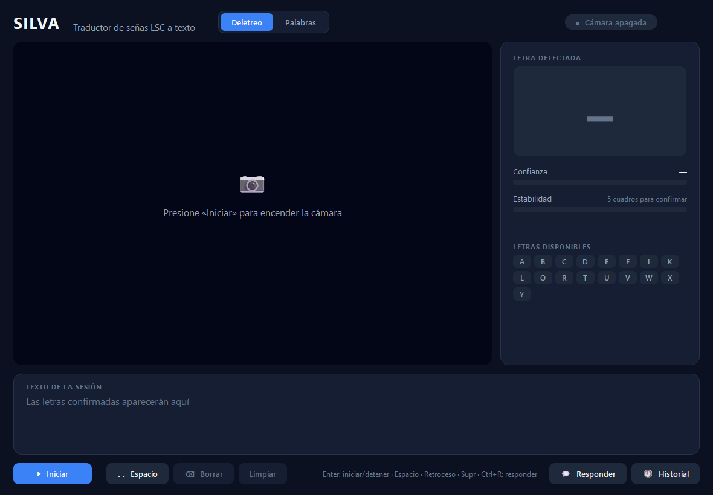
*Nota.* Elaboración propia. Selector de modo (Deletreo/Palabras), estado de la cámara y letras disponibles.

**Figura 2**
*Modo Deletreo con una letra confirmada*
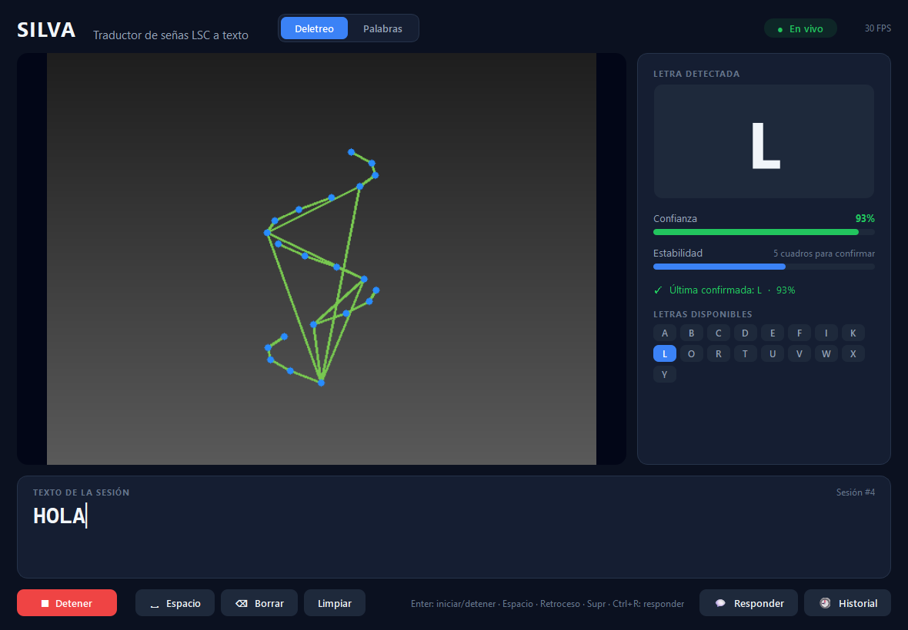
*Nota.* Elaboración propia. Letra reconocida con su confianza (RF-08), barra de estabilidad (RF-04), letra resaltada en la cuadrícula y texto acumulado (RF-05).

**Figura 3**
*Aviso de mano no detectada*
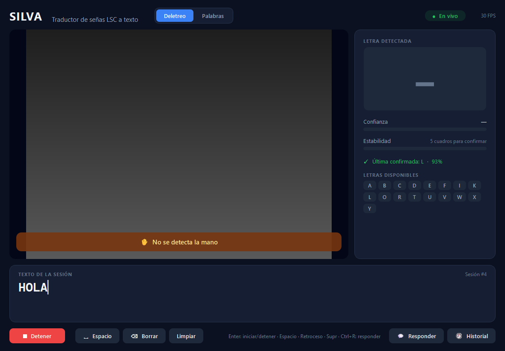
*Nota.* Elaboración propia. RF-06.

**Figura 4**
*Modo Palabras durante una seña*

*Nota.* Elaboración propia. Esqueleto de hombros, brazos y manos; indicador «Grabando seña»; palabra confirmada (RF-10).

**Figura 5**
*Seña dudosa: el sistema pide repetirla*
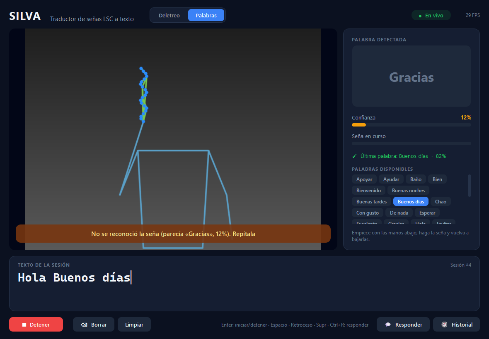
*Nota.* Elaboración propia. RF-11: con confianza bajo el umbral, la palabra no se escribe.

**Figura 6**
*Respuesta de la persona oyente mostrada en grande*
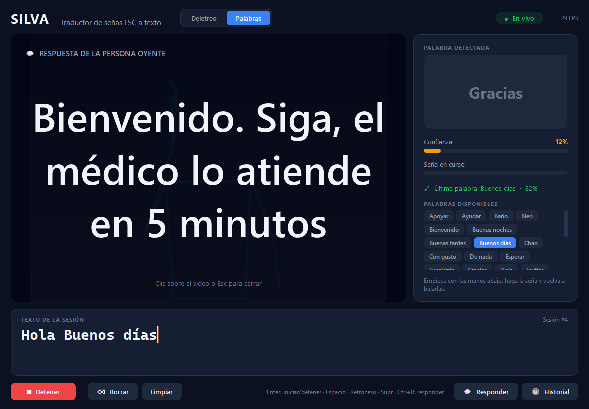
*Nota.* Elaboración propia. RF-09: la letra se ajusta automáticamente para ocupar el área del video.

**Figura 7**
*Cuadro para escribir la respuesta*
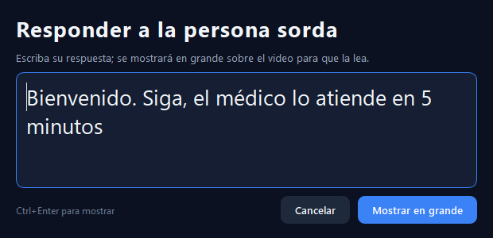
*Nota.* Elaboración propia.

**Figura 8**
*Historial de sesiones y respuestas*
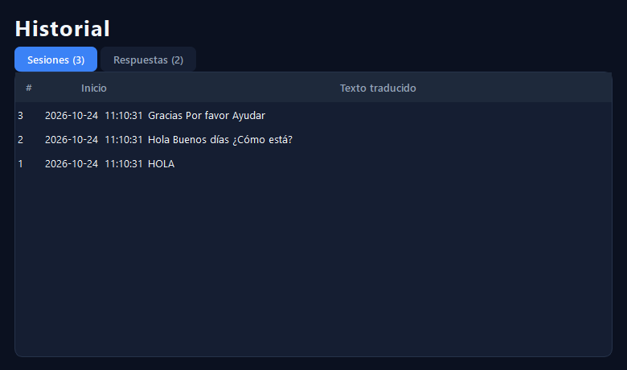
*Nota.* Elaboración propia. RF-07 y RF-09.

**Evidencia técnica adicional:**
- Reportes de métricas generados por los scripts de entrenamiento: [docs/metricas_modelo.md](../docs/metricas_modelo.md) y [docs/metricas_palabras.md](../docs/metricas_palabras.md).
- Informe de autoverificación del ejecutable (PR-40).
- Registro de pruebas: [docs/pruebas.md](../docs/pruebas.md).

## 10.7 Resultados frente a los objetivos

**Objetivo general:** *desarrollar un prototipo de escritorio que reconozca y traduzca a texto, en tiempo real, señas estáticas del lenguaje de señas mediante el análisis de la posición de los dedos y las manos capturados por cámara web.*

**Alcanzado y superado.** SILVA 1.0.0:
- Traduce 17 letras estáticas a 30 FPS con la cámara real.
- Traduce, además, 33 expresiones con movimiento.
- Permite la respuesta de la persona oyente.
- Se distribuye como ejecutable.

Evidencia: secciones 10.2, 10.3 y 10.6.

| # | Objetivo específico | Grado | Evidencia y valoración |
|---|---|---|---|
| 1 | Módulo de captura y detección de manos en tiempo real con OpenCV y MediaPipe | **Alcanzado** | `CapturaVideo`, `DetectorManos` y `DetectorCuerpo`; 13,9 ms por cuadro (PR-13); 30–31 FPS con la cámara (PR-37) |
| 2 | Construir un dataset propio de señas estáticas | **Parcial** | Se construyó el **proceso**: el script `capturar_dataset.py`, que graba muestras etiquetadas por persona, y la integración automática al entrenamiento. Pero el modelo actual se entrenó con un dataset externo (JuanPlazas, 2026), porque el equipo aún no ha grabado sus muestras. Para completarlo, cada integrante debe grabar unos 15 minutos y volver a entrenar |
| 3 | Entrenar un modelo que identifique la seña a partir de los landmarks | **Alcanzado** | Random Forest de letras (99,9 % en secuencias nuevas de la misma persona) y Extra Trees de palabras (85,6 % con personas no vistas). Se compararon 4 clasificadores × 3 conjuntos de características para elegir (ver [docs/dataset.md](../docs/dataset.md)) |
| 4 | Integrar el modelo en una app de escritorio que muestre la predicción en tiempo real | **Alcanzado** | Interfaz PySide6 con video, predicción, confianza, texto e historial (Figuras 2 y 4); ejecutable de Windows (PR-40) |
| 5 | Evaluar la precisión con distintos usuarios y condiciones de iluminación | **Parcial** | **Palabras:** evaluadas con personas no vistas (validación cruzada por persona, 18 personas) y con una prueba de punta a punta (82,5 %). **Letras:** el dataset es de una sola persona, así que su precisión con usuarios nuevos no está medida. **Iluminación:** no se ha evaluado. Las pruebas PR-23 y PR-24 están definidas y el script de entrenamiento ya calcula la generalización por persona cuando hay datos propios |

## 10.8 Limitaciones y trabajo futuro

**Limitaciones actuales** (lo que la versión 1.0.0 no resuelve):
1. **Vocabulario cerrado:** 17 letras y 33 expresiones. No traduce frases libres ni respeta la gramática de la LSC.
2. **Letras con movimiento:** G, H, J, M, N, Ñ, P, Q, S y Z no se reconocen.
3. **Precisión de letras con usuarios nuevos:** desconocida, porque el dataset de letras es de una sola persona.
4. **Encuadre en modo Palabras:** las 18 personas del dataset estaban de pie y de frente, con fondo claro. Sentado frente a un portátil puede no verse bien el torso; esto no se ha probado (PR-29).
5. **Confusiones entre señas parecidas:** *Buenas noches* y *Buenos días*, *Chao* y *Hola*, *Mal* y *Sí*.
6. **Señas separadas:** cada seña debe empezar y terminar con las manos abajo; no reconoce señas encadenadas sin pausa.
7. **Validación con la comunidad sorda:** no ha habido validación con usuarios reales ni con personas con conocimiento de LSC (ya señalado en el segundo corte).
8. **Plataforma:** solo Windows. El ejecutable pesa 228 MB, usa unos 745 MB de RAM y no está firmado digitalmente.
9. **Licencia:** por la licencia CC BY-NC de LSC-54, SILVA no puede usarse con fines comerciales.

**Trabajo futuro** (mejoras propuestas, no implementadas):
- **Datos propios del equipo:** grabarlos (objetivo 2) y medir la precisión con usuarios nuevos (objetivo 5).
- **Señas con movimiento:** un modelo de secuencias (por ejemplo LSTM) para las letras con movimiento y para señas encadenadas sin pausa.
- **Más vocabulario:** ampliarlo con datos propios o con otros datasets colombianos (por ejemplo LSC70; Muñoz Galindez et al., 2025).
- **Respuesta en señas:** convertir la respuesta del oyente en señas, por ejemplo con un avatar, en vez de solo texto.
- **Otras plataformas:** versiones para macOS y Linux, y firma digital del ejecutable.

## 10.9 Conclusiones

1. **Sobre el producto.** Con una cámara web y procesamiento local es viable traducir en tiempo real un vocabulario cerrado de LSC, sin hardware especial ni conexión. Eso confirma la hipótesis del problema (secciones 1 y 4.2 del segundo corte). La función Responder mostró que la traducción en un solo sentido no basta para una conversación.
2. **Sobre las decisiones técnicas.**
   - Las decisiones más importantes salieron de medir: qué letras son estáticas, qué categorías de LSC-54 incluir, qué clasificador usar y por qué las señas se partían.
   - Evaluar separando personas completas, y no cuadros sueltos, fue lo que permitió reportar cifras honestas: la diferencia entre 99,9 % con una persona y 85,6 % con personas nuevas es la diferencia entre un prototipo de laboratorio y uno útil.
3. **Sobre el diseño.** La separación entre interfaz y controlador del modelado UML pagó dividendos: cambiar toda la interfaz (C5) no afectó la lógica ni sus pruebas, y el paralelismo de la Figura 6 pudo implementarse tal como se había modelado.
4. **Sobre la calidad.** Las pruebas automáticas encontraron errores que no se habrían visto a simple vista (SQLite entre hilos, la imagen liberada al detener). La verificación con herramientas del sistema operativo encontró una fuga de privacidad en una dependencia (C6). Un requisito no funcional como RNF-01 debe verificarse, no suponerse.
5. **Sobre el proceso.** El alcance cambió de forma importante durante la construcción (C3, C4) y la construcción se concentró en pocos días. Para la siguiente versión, el equipo debe:
   - registrar los cambios en el tablero cuando ocurren;
   - repartir el trabajo con evidencia individual en Git;
   - pedir la aprobación del docente antes de ampliar el alcance, y no después.

---

## 11. Diagramas técnicos actualizados

Los diagramas del segundo corte ([SILVA_diagramas_UMLv2.pdf](SILVA_diagramas_UMLv2.pdf)) siguen siendo válidos para el modo Deletreo. Estos los actualizan con los cambios C3 a C7. Están en notación Mermaid, que GitHub muestra como diagrama.

**Figura 9**
*Diagrama de clases actualizado (versión 1.0.0)*

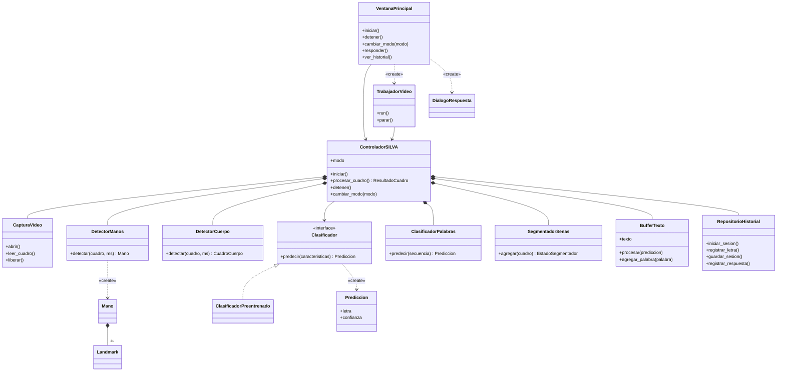

*Nota.* Elaboración propia. Clases nuevas respecto a la Figura 2 del modelado: `TrabajadorVideo`, `DialogoRespuesta`, `DetectorCuerpo`, `SegmentadorSenas` y `ClasificadorPalabras`.

**Figura 10**
*Secuencia del modo Palabras (CU-02 ampliado)*

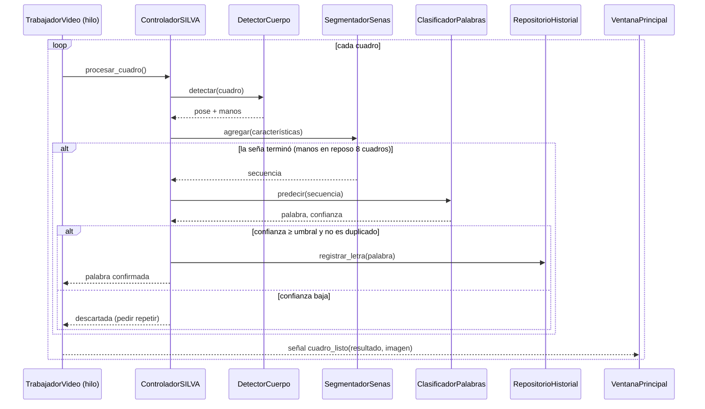

*Nota.* Elaboración propia.

**Figura 11**
*Diagrama de componentes actualizado*

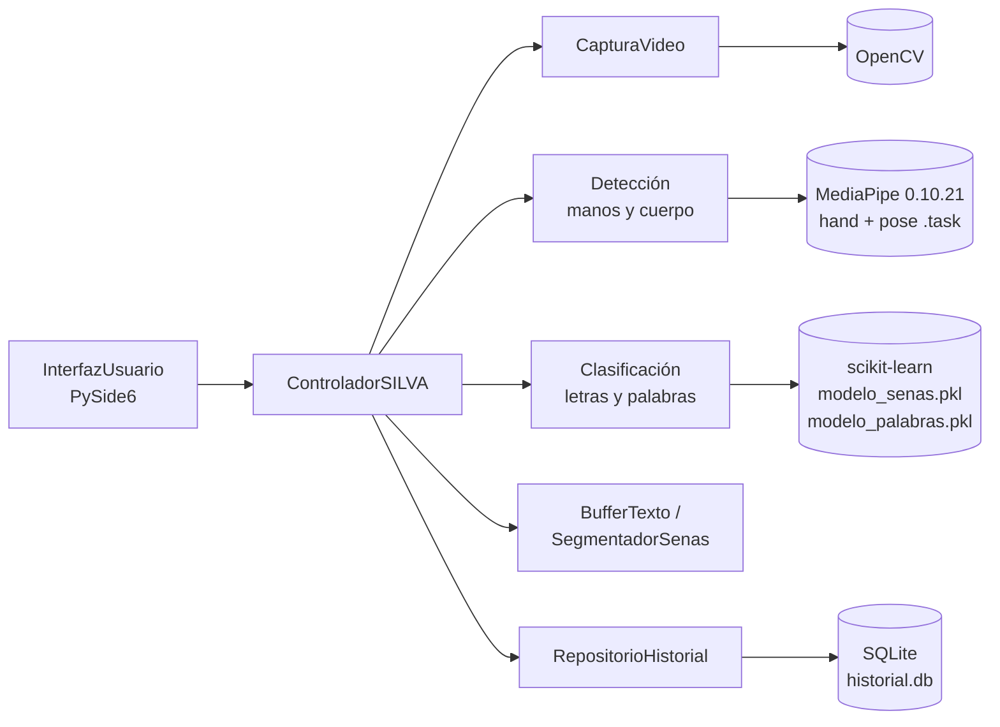

*Nota.* Elaboración propia. Las dependencias apuntan hacia afuera, como en la Figura 7 del modelado.

**Figura 12**
*Diagrama de despliegue de la versión 1.0.0*

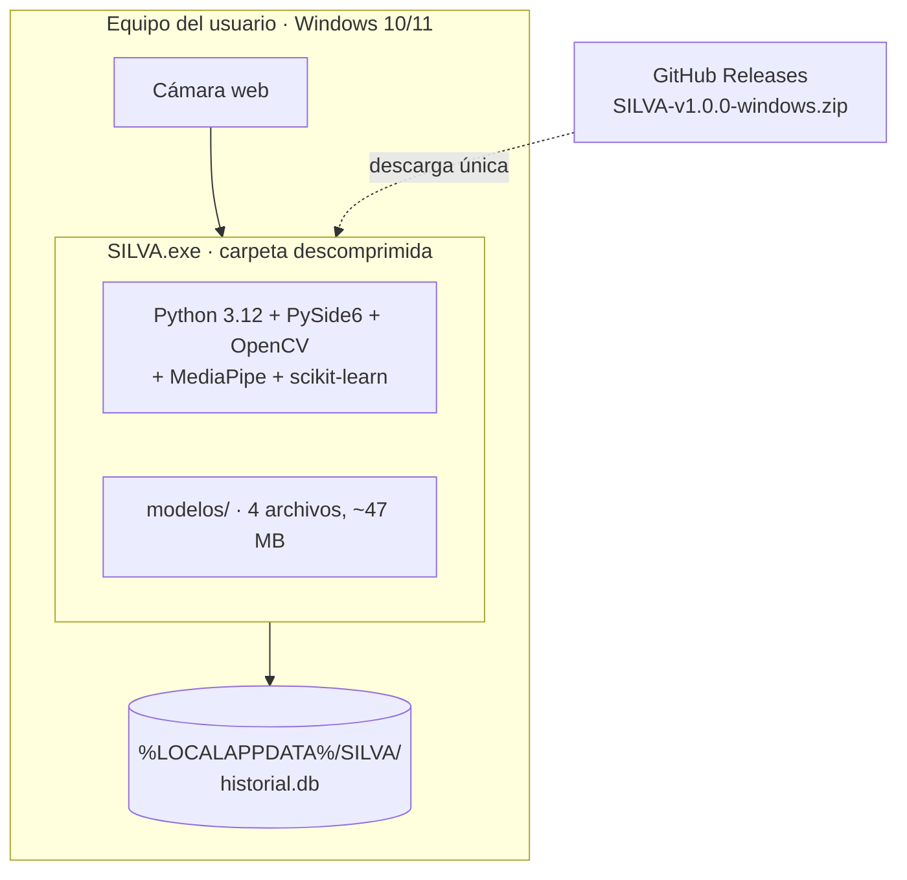

*Nota.* Elaboración propia. No hay servidor ni comunicación en tiempo de ejecución: GitHub solo interviene en la descarga (RNF-01 y RNF-02).

## 12. Registro de seguimiento

| Fecha | Avance presentado | Compromisos | Responsable(s) | Observaciones del docente |
|---|---|---|---|---|
| 14/09/2026 | Carpeta de planteamiento y diagramas propuestos | Completar el modelado UML | [completar] | [completar] |
| 16/09/2026 | Avance del corte 2: requerimientos, elicitación, tablero Trello | Repartir tarjetas; arrancar la construcción | [completar] | [completar] |
| 21/09/2026 | Justificación de decisiones; pregunta sobre la comunicación oyente → sorda | Definir la estructura técnica del repositorio | [completar] | [completar] |
| 08/10/2026 | MVP de letras, modo Palabras, migración a Qt y corrección de privacidad | Pruebas manuales con la cámara; aprobación de los cambios C3 y C4 | [completar] | [completar] |
| 24/10/2026 | Versión 1.0.0: Responder, ejecutable, documento del tercer corte | Subir a GitHub; publicar el Release; grabar datos propios; video demo | [completar] | [completar] |

## 13. Referencias

Bazarevsky, V., Grishchenko, I., Raveendran, K., Zhu, T., Zhang, F. y Grundmann, M. (2020). *BlazePose: On-device real-time body pose tracking*. arXiv. https://doi.org/10.48550/arXiv.2006.10204

Bradski, G. (2000). The OpenCV library. *Dr. Dobb's Journal of Software Tools, 25*(11), 120–125.

Breiman, L. (2001). Random forests. *Machine Learning, 45*(1), 5–32. https://doi.org/10.1023/A:1010933404324

cchadowitz. (2026, 7 de mayo). *Mediapipe now includes undocumented telemetry* (Issue #6291) [Reporte de error]. GitHub. https://github.com/google-ai-edge/mediapipe/issues/6291

Geurts, P., Ernst, D. y Wehenkel, L. (2006). Extremely randomized trees. *Machine Learning, 63*(1), 3–42. https://doi.org/10.1007/s10994-006-6226-1

JuanPlazas. (2026). *deteccion_letras_senas: Detección de letras en Lengua de Señas Colombiana (LSC)* [Software y conjunto de datos]. GitHub. https://github.com/JuanPlazas/deteccion_letras_senas

Linares Munar, L. (2023, 24 de septiembre). «Colombia tiene porcentaje bajo en la implementación de los derechos de las personas sordas», Insor. *Infobae*. https://www.infobae.com/colombia/2023/09/24/colombia-tiene-porcentaje-bajo-en-la-implementacion-de-los-derechos-de-las-personas-sordas-insor/

Lugaresi, C., Tang, J., Nash, H., McClanahan, C., Uboweja, E., Hays, M., Zhang, F., Chang, C.-L., Yong, M. G., Lee, J., Chang, W.-T., Hua, W., Georg, M. y Grundmann, M. (2019). *MediaPipe: A framework for building perception pipelines*. arXiv. https://doi.org/10.48550/arXiv.1906.08172

Mora-Zarate, J. E. (2025). *A dataset representing the movements that a person must perform to produce a sign* (Versión 4) [Conjunto de datos]. Science Data Bank. https://doi.org/10.57760/sciencedb.25639

Mora-Zarate, J. E., Garzón-Castro, C. L. y Castellanos-Rivillas, J. A. (2025). LSC-54: A landmark-based dataset for Colombian sign language. *Data in Brief, 63*, Artículo 112145. https://doi.org/10.1016/j.dib.2025.112145

Muñoz Galindez, J. A., Villota Coral, L. V. y Vargas Cañas, R. (2025). The dynamic Colombian sign language dataset for basic conversation LSC70. *Data in Brief, 58*, Artículo 111213. https://doi.org/10.1016/j.dib.2024.111213

Object Management Group. (2017). *OMG Unified Modeling Language (OMG UML), version 2.5.1*. https://www.omg.org/spec/UML/2.5.1/

Organización Mundial de la Salud. (2024). *Deafness and hearing loss* [Ficha técnica]. https://www.who.int/news-room/fact-sheets/detail/deafness-and-hearing-loss

Pedregosa, F., Varoquaux, G., Gramfort, A., Michel, V., Thirion, B., Grisel, O., Blondel, M., Prettenhofer, P., Weiss, R., Dubourg, V., Vanderplas, J., Passos, A., Cournapeau, D., Brucher, M., Perrot, M. y Duchesnay, É. (2011). Scikit-learn: Machine learning in Python. *Journal of Machine Learning Research, 12*, 2825–2830.

PyInstaller Development Team. (2026). *PyInstaller* (Versión 6.22) [Software]. https://pyinstaller.org

The Qt Company. (2026). *Qt for Python (PySide6)* (Versión 6.12) [Software]. https://doc.qt.io/qtforpython-6/

Zhang, F., Bazarevsky, V., Vakunov, A., Tkachenka, A., Sung, G., Chang, C.-L. y Grundmann, M. (2020). *MediaPipe Hands: On-device real-time hand tracking*. arXiv. https://doi.org/10.48550/arXiv.2006.10214

*Nota sobre las citas en el texto.* En el documento consolidado, citar en formato autor-fecha donde se usa cada fuente:
- (Lugaresi et al., 2019; Zhang et al., 2020) al describir la detección de manos.
- (Bazarevsky et al., 2020) al describir la detección de pose.
- (Breiman, 2001) para el modelo de letras y (Geurts et al., 2006) para el de palabras.
- (Pedregosa et al., 2011) para scikit-learn y (Bradski, 2000) para OpenCV.
- (JuanPlazas, 2026) y (Mora-Zarate, 2025; Mora-Zarate et al., 2025) para los datos.
- (cchadowitz, 2026) para la decisión C6.

## 14. Anexos

| Anexo | Contenido | Ubicación |
|---|---|---|
| A | Datasets: origen, licencias, análisis de letras estáticas, extracción de LSC-54 y comparación de modelos | [docs/dataset.md](../docs/dataset.md) |
| B | Métricas del modelo de letras | [docs/metricas_modelo.md](../docs/metricas_modelo.md) |
| C | Métricas del modelo de palabras, con reporte por seña y curva de umbrales | [docs/metricas_palabras.md](../docs/metricas_palabras.md) |
| D | Plan y registro completo de pruebas (PR-01 a PR-42) | [docs/pruebas.md](../docs/pruebas.md) |
| E | Créditos y licencias de terceros | [TERCEROS.md](../TERCEROS.md) |
| F | Manual de instalación y uso | [README.md](../README.md) y `LEEME.txt` dentro del ejecutable |
| G | Capturas de la interfaz | [docs/capturas/](../docs/capturas/) |

## 15. Declaración de uso de herramientas de inteligencia artificial

[Completar y revisar por el equipo.] Durante las iteraciones 1 a 4 se usó un asistente de programación con inteligencia artificial (Claude Code, de Anthropic) para escribir buena parte del código, los scripts de entrenamiento, las pruebas y el borrador de este documento, a partir de las instrucciones y decisiones del equipo. El equipo debe declarar aquí qué partes revisó, modificó y validó cada integrante, y confirmar que puede explicar y sustentar cada decisión técnica, como exigen los lineamientos del proyecto de aula (sección 3 de la plantilla: «Cada integrante deberá evidenciar participación real en el proyecto»).
