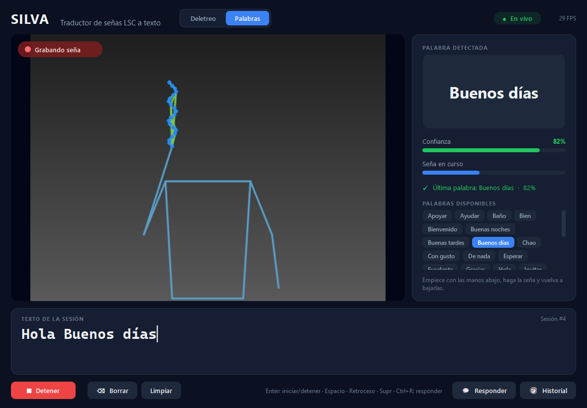

# SILVA

**Sistema Inteligente de Lenguaje Visual Aumentado** · versión 1.3.0

SILVA traduce a texto, en tiempo real, señas de la Lengua de Señas Colombiana (LSC) captadas con una cámara, y permite que la persona oyente responda por escrito o por voz, con las señas animadas. Funciona en Windows y en teléfonos Android. Todo se procesa en el equipo: no necesita internet ni envía video a ningún servidor.

Equipo 3, Ingeniería de Software (grupo 1206), Universidad Tecnológica de Bolívar: Miguel Alejandro Jácome Yánez, Camilo Andrés Conde Corrales y Juan Diego Rosales Guillén. Docente: Aisner José Marrugo Juliao.



## Descargar y usar (sin instalar nada)

En [Releases](https://github.com/CamiloConde/SILVA/releases) están los dos archivos de la última versión.

**Windows** · `SILVA-v1.3.0-windows.zip` (unos 315 MB)
1. Descomprímalo completo y abra `SILVA\SILVA.exe`.
   - Si Windows muestra «Windows protegió su PC», elija *Más información → Ejecutar de todas formas*. Aparece porque el ejecutable no está firmado digitalmente.
2. Presione **Iniciar** (o Enter).

Requisitos: Windows 10/11 de 64 bits, cámara web, 8 GB de RAM recomendados. El historial se guarda en `%LOCALAPPDATA%\SILVA\historial.db`. Para comprobar una instalación: `SILVA.exe --verificar --camara` crea un informe en `%LOCALAPPDATA%\SILVA\verificacion.txt`.

**Android** · `SILVA-v1.3.0-android.apk` (unos 87 MB)
1. Copie el `.apk` al teléfono (por cable a la carpeta *Download*, o por Google Drive) y ábralo desde *Archivos*.
2. Si Android lo pide, permita instalar apps de esa fuente. Si Play Protect avisa que la app no es conocida, toque *Más detalles → Instalar de todas formas*. El aviso sale porque la app no viene de la Play Store.
3. Abra SILVA y toque **Iniciar**. Pide la cámara; el micrófono solo si usa **Hablar**.

Requisitos: Android 7 o más reciente. La app no tiene permiso de internet, así que Android le impide enviar datos.

## Qué hace

| Modo | Qué reconoce | Cómo se usa |
|---|---|---|
| **Palabras** (modo inicial) | 33 expresiones de cortesía con movimiento: Apoyar, Ayudar, Baño, Bien, Bienvenido, Buenas noches, Buenas tardes, Buenos días, Chao, ¿Cómo está?, Con gusto, De nada, Esperar, Excelente, Gracias, Hola, Invitar, Lo siento, Mal, Más o menos, Muchas gracias, Muy bien, Muy mal, Necesitar, No, Perdón, Perfecto, Permiso, Por favor, Presentar, Sentarse, Sí, Tranquilo | Deben verse los hombros y las manos; una silueta indica dónde ubicarse. Empiece con las manos abajo, haga la seña y vuelva a bajarlas |
| **Deletreo** | Las **27 letras** del alfabeto dactilológico. 20 se sostienen quietas (A B C D E F I K L M N O P R T U V W X Y) y 7 se trazan (G H J Ñ Q S Z) | Sostenga la seña hasta que se llenen los 5 segmentos (confianza ≥ 0,60 durante 5 cuadros). Para las letras con trazo, haga la forma, trace el movimiento y quédese quieto un momento |
| **Responder** (Ctrl+R) / **Texto a señas** | — | La persona oyente escribe (o dicta, en el teléfono) y el texto se muestra en grande, con la seña animada de cada palabra del vocabulario |

Además:
- **Palabras al instante:** la palabra reconocida se escribe enseguida. Durante 3 s se puede cambiar por otra de sus 3 opciones (1, 2, 3) o borrar (X).
- **«¿Quisiste decir?»:** si la seña es dudosa, ofrece 3 opciones y no escribe nada salvo que alguien elija. Al deletrear, sugiere cómo completar la palabra (por ejemplo «HOLA MUN» → MUNDO) con las 20 000 palabras más frecuentes del español.
- **Seguimiento de la mano:** si MediaPipe pierde una mano a mitad de la seña, la vuelve a buscar en un recorte ampliado alrededor de la muñeca del esqueleto.
- **Avisos:** cuando no ve la mano o a la persona, cuando hay que acercarse o alejarse y cuando hay **poca luz** (los movimientos salen borrosos y se pierde la mano).
- **Señas animadas:** una figura de persona hace las 33 señas del vocabulario. Se generan con los puntos de las grabaciones de LSC-54, sin usar los videos.
- **Leer en voz alta y copiar** el texto traducido (voz de Windows o del teléfono, sin internet).
- Guarda cada sesión y cada respuesta en un historial local.

**Precisión con personas que el modelo nunca vio:**
- **Letras quietas:** 88,2 % (70 personas de LSC70). Con confianza ≥ 0,60 escribe el 85 % de las señas y acierta el 96 % de lo que escribe.
- **Letras con trazo:** 79 %. Escribe el 58 % de esas letras, con 96 % de acierto; al pasar de una letra quieta a otra, escribe una letra con trazo falsa el 9 % de las veces.
- **Palabras:** 85,3 %, y 76,7 % con personas grabadas en otro entorno (LSC50).
  - La app escribe sola el 56 % de las señas, con 96 % de acierto, y otro 17 % lo ofrece como «¿Quisiste decir?» (la correcta está entre las 3 opciones el 96 % de las veces).
  - Ante movimientos que no son del vocabulario escribe una palabra el 12 % de las veces (versión 1.0.0: 81 %), y se puede borrar con X.

El detalle está en [docs/metricas_modelo.md](docs/metricas_modelo.md), [docs/metricas_letras_movimiento.md](docs/metricas_letras_movimiento.md) y [docs/metricas_palabras.md](docs/metricas_palabras.md).

**Límites:**
- Reconoce señas sueltas de un vocabulario cerrado, no frases libres con la gramática de la LSC.
- Las letras con trazo se entrenaron con 6 imágenes por seña (LSC70 no trae video), así que el momento en que empieza y termina el trazo en vivo está estimado, no medido.

## App de escritorio

| Control | Acción |
|---|---|
| **Iniciar / Detener** · Enter | Enciende o apaga la cámara. Al detener, la sesión se guarda en el historial |
| **Palabras / Deletreo** | Cambia de modo |
| **Espacio** | Deletreo: separa palabras. Palabras: deja la palabra como está |
| **Borrar** · Retroceso | Borra la última letra o palabra |
| **Limpiar** · Supr | Borra todo el texto |
| **1 · 2 · 3** / **X** (Palabras) | Cambiar la palabra recién escrita por esa opción, o elegirla en «¿Quisiste decir?» / borrarla |
| **Leer en voz alta** · **Copiar** | Lee el texto con la voz de Windows o lo copia |
| **Responder** · Ctrl+R | Escribir una respuesta y mostrarla en grande con sus señas. Para cerrarla: clic sobre el video o Esc |
| **Historial** | Sesiones traducidas y respuestas guardadas |
| **Ajustes** | Elegir la cámara (por ejemplo el celular como cámara web, con DroidCam o Iriun) y el tamaño del texto |

Para escribir la misma letra dos veces seguidas (por ejemplo "LL"), retire la mano del cuadro entre una y otra.

## App para Android

La app del teléfono reconoce lo mismo que la de escritorio: usa los mismos clasificadores, exportados a un formato propio, y MediaPipe para Android. Se usa en vertical y tiene cuatro secciones:

- **Señas a texto:** la cámara (trasera o frontal), la letra o palabra detectada, el texto traducido con «Escuchar» y «Copiar», y «¿Quisiste decir?». **Pantalla completa** muestra la cámara en grande con la traducción debajo.
- **Texto a señas:** se escribe o se dicta una frase y aparece en grande con las señas animadas. «Vocabulario» muestra las 33 palabras.
- **Conversar:** la conversación con lo señado, lo escrito y lo dicho, con «Texto grande» para leer de lejos y «Ver en señas» en cada mensaje.
- **Historial.**

Para que reconozca mejor: en Palabras, apoye el teléfono a 1,5–2 m para que se vean los hombros y las dos manos; con buena luz de frente. Si se seña a sí mismo, use la cámara frontal.

«Hablar» usa el reconocedor de voz del teléfono sin conexión cuando existe; si no, el de Android, que puede enviar el audio a Google. El video nunca sale del teléfono.

## Ejecutar desde el código fuente

Requiere **Python 3.10, 3.11 o 3.12** (MediaPipe no soporta versiones más nuevas).

```bash
git clone https://github.com/CamiloConde/SILVA
cd SILVA
python -m venv .venv
```

Active el entorno con `.venv\Scripts\activate` en Windows o `source .venv/bin/activate` en macOS/Linux, y luego:

```bash
pip install -r requirements.txt
pip install -e .
python -m silva
```

Los modelos ya vienen en `modelos/`, así que después de instalar la app funciona sin internet.

> **No actualice MediaPipe en la app de escritorio.** Está fijo en la versión 0.10.21 porque las versiones que publica Google desde la 0.10.22 envían estadísticas de uso a Google (`play.googleapis.com`) sin forma de desactivarlo ([issue #6291](https://github.com/google-ai-edge/mediapipe/issues/6291)). Eso incumpliría el requisito RNF-01. Con 0.10.21 se verificó con `netstat` que la app no abre ninguna conexión.
>
> La app de Android usa MediaPipe 0.10.29, porque la 0.10.21 no carga en teléfonos con páginas de memoria de 16 KB. Como la app no tiene permiso de internet, Android bloquea esos envíos.

## Pruebas

```bash
python -m pytest -v
```

Son 81 pruebas automáticas:
- Regla de confirmación de letras, letras con trazo y normalización de puntos.
- Detectores reales de MediaPipe y los tres clasificadores.
- Segmentación de señas, escritura inmediata, corrección y recuperación de la mano perdida.
- Sugerencias de «¿Quisiste decir?» y animaciones de las señas.
- Historial y respuestas.
- Controlador en ambos modos.
- Interfaz: ciclos Iniciar/Detener con el hilo de video, modos, edición, Responder e historial.
- Ejecución sin red y tiempo por cuadro.

La app de Android tiene 12 pruebas más (`movil\gradlew.bat -p movil testDebugUnitTest`). Comparan sus características, probabilidades, constantes y búsqueda de señas con casos generados por Python, para asegurar que el teléfono calcula lo mismo que el PC.

El plan completo, con las pruebas manuales, está en [docs/pruebas.md](docs/pruebas.md).

## Construir el ejecutable y el APK

**Windows:**

```bash
pip install pyinstaller
python scripts/construir_ejecutable.py
```

El script hace tres cosas:
1. Empaqueta con PyInstaller ([empaquetado/silva.spec](empaquetado/silva.spec)).
2. Verifica que el ejecutable cargue todos los modelos por sí solo.
3. Genera `dist/SILVA-v1.3.0-windows.zip`, que es el archivo que se sube a *Releases*.

**Android** (requiere el SDK de Android y un JDK 17 o más reciente, por ejemplo el de Android Studio):

```bash
python scripts/exportar_movil.py
```

```bash
movil\gradlew.bat -p movil assembleRelease
```

`exportar_movil.py` copia los modelos, los casos de prueba y la lista de palabras a `movil/app/src/main/assets`. El APK queda en `movil/app/build/outputs/apk/release/app-release.apk`; se renombra como `SILVA-v1.3.0-android.apk`. Está firmado con la clave de desarrollo: se instala sin problema, pero para la Play Store habría que firmarlo con una clave propia.

Pasos para publicar:
1. En GitHub, entre a **Releases** y luego a **Draft a new release**.
2. Cree la etiqueta `v1.3.0`.
3. Adjunte el `.zip` y el `.apk`.
4. Publique con **Publish release**.

## Reentrenar los modelos

**Letras quietas:**

```bash
python scripts/preparar_dataset.py
python scripts/preparar_lsc70.py
python scripts/capturar_dataset.py --persona camilo
python scripts/entrenar_modelo.py
```

`preparar_dataset.py` descarga el dataset de una persona de JuanPlazas. `preparar_lsc70.py` extrae las letras de LSC70 (70 personas; requiere `LSC70.zip` de [Mendeley Data](https://doi.org/10.17632/9ssyn8tff5.2) en `data/externo/lsc70/`). `capturar_dataset.py` es opcional: sirve para grabar muestras propias.

**Letras con trazo:** `data/landmarks/lsc70_secuencias.npz` ya trae las secuencias, así que basta con:

```bash
python scripts/entrenar_letras_movimiento.py
```

Para extraerlas de nuevo desde LSC70: `python scripts/preparar_lsc70_secuencias.py`.

**Palabras:** `data/landmarks/lsc54_secuencias.npz` y `lsc50_secuencias.npz` ya traen los puntos extraídos, así que basta con:

```bash
python scripts/entrenar_palabras.py
```

Para extraerlos de nuevo desde los videos:
1. Descargue los tres zips de `RawVideos` de [LSC-54](https://doi.org/10.57760/sciencedb.25639) (unos 970 MB) en `data/externo/lsc54/`.
2. Ejecute `python scripts/extraer_lsc54.py`. En un equipo de 16 núcleos tarda unos 30–40 minutos.

Después de reentrenar, `python scripts/generar_animaciones.py` regenera las señas animadas y `python scripts/exportar_movil.py` lleva los modelos a la app de Android.

## Arquitectura

```
Cámara ─► CapturaVideo ─► DetectorManos / DetectorCuerpo (MediaPipe) ─► Clasificador / LetrasMovimiento / ClasificadorPalabras
                                    │                                           │
                          (hilo de video: TrabajadorVideo)            BufferTexto / SegmentadorSenas
                                    │                                           │
                          VentanaPrincipal (PySide6) ◄──── ControladorSILVA ────► RepositorioHistorial (SQLite)
```

- La ventana usa **PySide6 (Qt)**. La cámara y MediaPipe corren en un hilo aparte, así la ventana nunca se congela; es el paralelismo de la Figura 6 del modelado UML. En modo Palabras, la pose y las manos se calculan en paralelo.
- Los accesos al controlador desde los dos hilos se ordenan con un candado.
- La app de Android repite el mismo flujo en Kotlin (`movil/app/src/main/java/co/edu/utb/silva/nucleo`), con CameraX y Jetpack Compose.
- Los diagramas actualizados están en [Planteamiento/SILVA_entrega_corte3.md](Planteamiento/SILVA_entrega_corte3.md).

```
SILVA/
├── Planteamiento/          # Entregas de los cortes 1, 2 y 3
├── src/silva/              # Código de la aplicación de escritorio
│   ├── interfaz.py             VentanaPrincipal, TrabajadorVideo, Responder, Ajustes (PySide6)
│   ├── controlador.py          ControladorSILVA (modos Palabras y Deletreo)
│   ├── captura_video.py        CapturaVideo (OpenCV)
│   ├── detector_manos.py       DetectorManos (MediaPipe) + normalización de la mano
│   ├── cuerpo.py               DetectorCuerpo (pose + 2 manos + recuperación) y características por cuadro
│   ├── palabras.py             SegmentadorSenas y ClasificadorPalabras
│   ├── clasificador.py         Clasificador / ClasificadorPreentrenado (letras quietas)
│   ├── letras_movimiento.py    Letras con trazo (G H J Ñ Q S Z)
│   ├── buffer_texto.py         BufferTexto (regla de 0,60 y 5 cuadros)
│   ├── sugerencias.py          «¿Quisiste decir?» al deletrear
│   ├── animacion.py            Señas animadas
│   ├── repositorio_historial.py RepositorioHistorial (SQLite: sesiones, letras, respuestas)
│   ├── config.py               Rutas y constantes (también dentro del ejecutable)
│   └── modelo.py               Landmark, Mano, Prediccion
├── movil/                  # App de Android (Kotlin)
├── scripts/                # Preparar datos, entrenar, exportar al teléfono, construir el ejecutable
├── tests/                  # 81 pruebas con pytest
├── data/landmarks/         # Puntos extraídos de los datasets (.npz)
├── modelos/                # MediaPipe (manos, pose), clasificadores y animaciones
├── empaquetado/            # PyInstaller: especificación, lanzador y LEEME del ejecutable
├── recursos/               # Logo, ícono, fuentes IBM Plex y lista de palabras
└── docs/                   # Datasets, métricas, plan de pruebas, capturas y bocetos
```

## Créditos y licencias

- **Datos:** JuanPlazas (2026), letras de LSC (uso académico citando la autoría); Muñoz Galindez et al. (2024), LSC70 (CC BY 4.0); Mora-Zarate (2025), LSC-54 (**CC BY-NC 4.0**); Flórez-Sierra et al. (2024), LSC50 (CC BY 4.0); y FrequencyWords de Hermit Dave, lista de palabras del español (CC BY-SA 4.0). Como el modelo de palabras y las animaciones se derivan de LSC-54, **SILVA no puede usarse con fines comerciales**.
- **Software:** MediaPipe (Apache 2.0), PySide6/Qt (LGPL v3), OpenCV (Apache 2.0), scikit-learn y NumPy (BSD); en Android, CameraX, Jetpack Compose y Kotlin (Apache 2.0). Fuentes IBM Plex Sans y Mono (SIL OFL 1.1).
- El detalle está en [TERCEROS.md](TERCEROS.md).
- El equipo aún no ha definido la licencia de su propio código.
